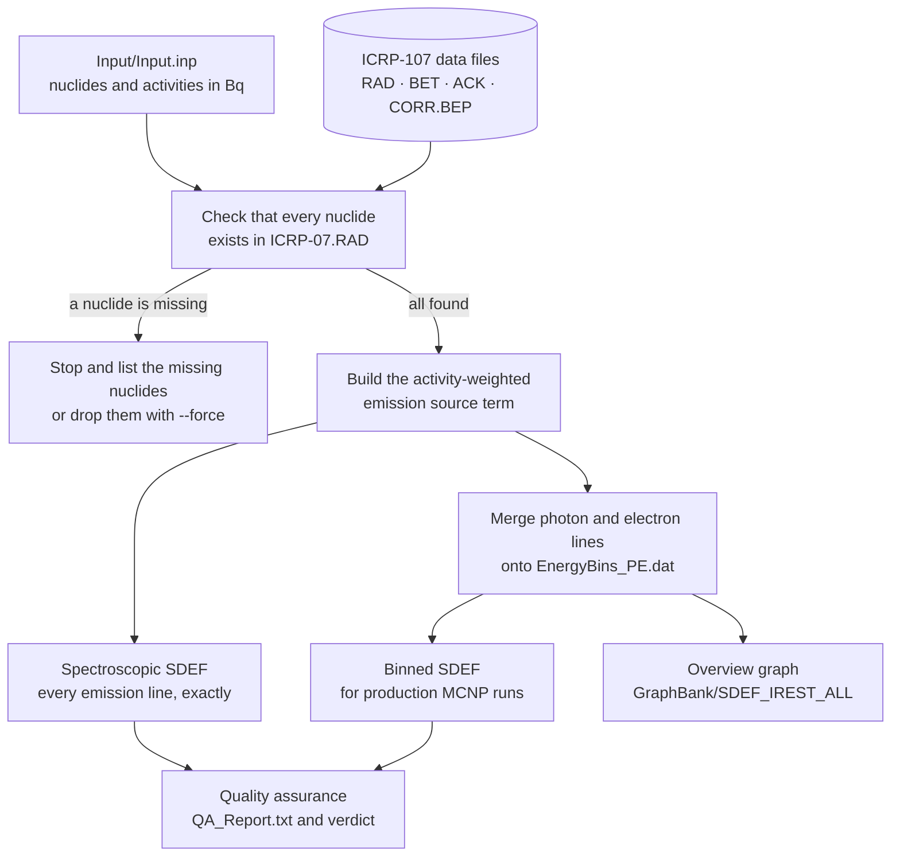
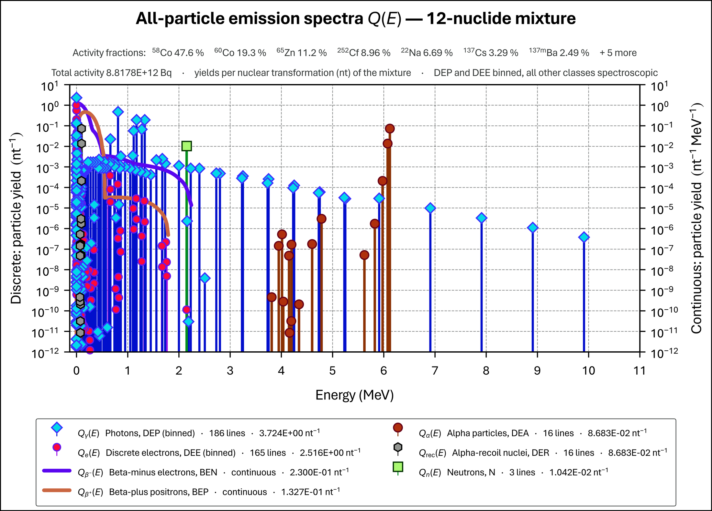
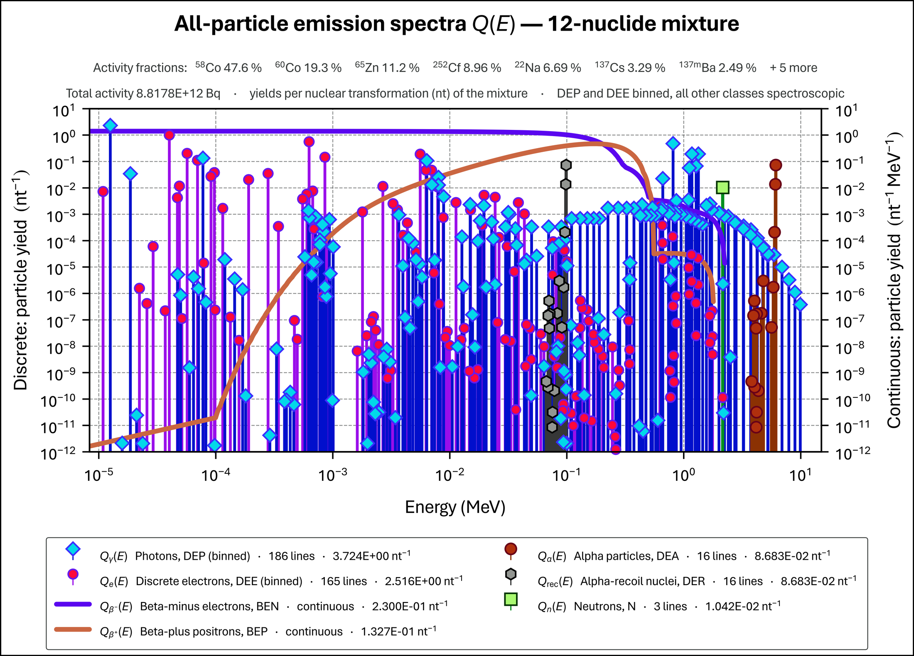

# MCNP_SOURCE_APP — User Guide

**Version 2.1** · guide revised November 2026

*From a radionuclide inventory to a ready-to-use MCNP6 source definition — explained step by step.*

[TOC]

> [!TIP]
> **Reading this guide in Typora.** The guide uses a little mathematical notation, such as $A_i$ for the activity of nuclide $i$. If you see raw dollar signs instead of neat formulas, switch on inline maths once: **File ▸ Preferences ▸ Markdown ▸ Syntax Support ▸ Inline Math**, then reopen the file. The flow diagram and the example graphs display without any setting.

---

## 1. Welcome

### 1.1 What problem does MCNP_SOURCE_APP solve?

Computational radiation-protection work very often starts with an **activity inventory**: you are told that a waste drum, a shielded flask, a hot cell or a decommissioning item contains so many becquerel of Co-60, so many of Cs-137, a trace of U-238, and so on. Written formally, the inventory is a list of pairs $(i; A_i)$ — the identity $i$ of each radionuclide and its activity $A_i$ in Bq.

Each of those nuclides emits its own characteristic mixture of ionising radiations. Depending on the nuclide, that can include:

* **photons** — gamma rays, X-rays, and the prompt and delayed gamma rays that accompany spontaneous fission;
* **discrete-energy electrons** — internal-conversion electrons and Auger / Coster-Kronig electrons;
* **beta particles** — negative (electrons, β⁻) and positive (positrons, β⁺), each with a *continuous* energy spectrum;
* **alpha particles**, together with the **recoiling nucleus** left behind when an alpha is emitted;
* for the heavy, spontaneously fissioning nuclides, **neutrons** and **fission fragments**.

Taken together, these radiations form the **ionising radiation emission source term**, abbreviated **IREST** in this guide. Formally it is a set of energy–yield tables $(E_g; Y_g)_j$, one table for each particle class $j$, where $g$ counts the energies.

To transport these radiations through a model in **MCNP6**, you have to describe them in an **SDEF** (source definition) block. Doing that by hand is not realistic. Even a modest inventory produces hundreds or thousands of emission lines. Every line must be weighted by its nuclide's share of the total activity. Lines that coincide in energy must be merged. The beta spectra must be tabulated as continuous distributions. And at the end, every number must still add up to the right total.

**MCNP_SOURCE_APP does all of this automatically.** It reads your inventory, looks up every emission of every nuclide in the ICRP Publication 107 decay-data files, builds the combined source term, writes it as a ready-to-paste MCNP6 SDEF block, checks its own work, and draws a graph of the result.

### 1.2 What one run gives you

Every ordinary run writes four things:

| Output | File | What it is | What you use it for |
|---|---|---|---|
| **Spectroscopic SDEF** | `Output_Spectroscopic_Case/SDEF_MCNP6_spectroscopic.out` | The source term with **every** emission line exactly as ICRP-107 gives it | The reference record; the benchmark against which the binned deck is justified |
| **Binned SDEF** | `Output_Binned/SDEF_MCNP6_binned.out` | The same source term, with the photon and discrete-electron lines merged onto a fixed energy grid | **Your production MCNP runs** |
| **QA report** | `Output_Spectroscopic_Case/QA_Report.txt` | The code's own verification of both decks, ending in a verdict: PASS, WARN or FAIL | File it with your calculation; read the verdict before using a deck |
| **Overview graph** | `GraphBank/SDEF_IREST_ALL.svg` / `.pdf` / `.png` | A picture of all particle classes on one energy axis | Reports, presentations, and a quick sanity check by eye |

On request, the code can also build a **library of per-nuclide SDEF files** for all ~1250 nuclides in ICRP-107 (Section 10).

### 1.3 How this guide is organised

You do not need to read everything at once.

* **In a hurry?** Section 2 takes you through your first run in five steps.
* **Want to know what happens inside?** Section 3 explains the method, in particular the important idea of yields *per average decay of the mixture*.
* **Preparing inputs and running:** Sections 4 and 5.
* **Using the results in MCNP:** Section 6 — including how to convert MCNP's "per source particle" results into real-time results per second.
* **Physics background:** Section 7 explains the corrections this code makes to how beta-plus emitters and fission fragments were previously handled.
* **Checking and presenting results:** Section 8 (the QA report) and Section 9 (the graph).
* **Reference material:** Sections 10 to 17 cover the per-nuclide library, saving to GitHub, the folder layout, the data files, maintenance, troubleshooting, a glossary and the version history.

---

## 2. Quick start — your first run in five steps

### Step 1 — Install Python and the two packages (once only)

You need **Python 3.12 or newer**. Open a terminal (Command Prompt, PowerShell or the terminal inside VS Code) in the project folder and type:

```
python --version
python -m pip install -r requirements.txt
```

The first command confirms which Python you have. The second installs **numpy** (the numerical engine) and **matplotlib** (for the graph). This only needs doing once per computer.

### Step 2 — Describe your inventory

Open `Input/Input.inp` in any text editor and list your nuclides and activities between `@Start` and `@End`:

```
Num_Beta_Eng_Points  900
@Start
Co60     1.7E12
Cs137    2.9E11
Ba137m   2.2E11
Sr90     1.9E10
Y90      1.88E10
@End
```

One nuclide per line, the name first, then the activity **in becquerel**. Section 5 explains every rule and option.

### Step 3 — Run the code

The easiest way is to **double-click `Run.cmd`** in the project folder. A window opens, the run takes some ten to twenty seconds (most of that is drawing the graph), and the window waits for a key press at the end so that you can read the messages.

Alternatively, in a terminal in the project folder:

```
python MCNP_SOURCE_APP.py
```

### Step 4 — Check the verdict

The last block of the screen output is the quality-assurance verdict:

```
======================================================================
 QA VERDICT: PASS   (33 passed, 0 warnings, 0 failures)
======================================================================
```

* **PASS** — everything checked out; carry on.
* **WARN** — the decks are usable, but something rests on an approximation. Open `QA_Report.txt` and read what it says.
* **FAIL** — **do not use the decks.** The report explains which check failed (Section 8).

### Step 5 — Collect your results

* Copy the **binned deck** `Output_Binned/SDEF_MCNP6_binned.out` into your MCNP input (Section 6.4 gives a checklist).
* Keep the **QA report** with your calculation records.
* Look at the **graph** in `GraphBank/` — it is the quickest way to see whether the source term looks as you expect.

That is the whole cycle. The rest of this guide explains each part in depth.

---

## 3. How it works — the big picture

### 3.1 The flow of a run



In words, a run goes through these stages:

1. **Read the inventory.** The code reads `Input/Input.inp`, tidies up the nuclide names, adds up any nuclide that is listed twice, and reports the total activity.
2. **Read the decay data.** It loads, for your nuclides only, the ICRP-107 files: discrete radiations (`ICRP-07.RAD`), beta spectra (`ICRP-07.BET`), detailed Auger-electron spectra (`ICRP-07.ACK`) and the project's evaluated positron spectra (`ICRP-07-CORR.BEP`).
3. **Check availability.** If any nuclide in your inventory has no data in `ICRP-07.RAD`, the run stops and tells you which (Section 5.6).
4. **Build the source term.** Every emission of every nuclide is weighted by that nuclide's activity fraction and sorted into one of nine particle classes. Lines that fall at exactly the same energy are summed. The beta spectra of all nuclides are combined onto one shared energy grid.
5. **Write the spectroscopic deck.** This is the exact, unabridged source term.
6. **Bin and write the binned deck.** The photon and discrete-electron classes are merged onto a fixed energy partition to keep the deck manageable for Monte Carlo sampling (Section 6.2).
7. **Verify.** Both decks are read back from disk and checked against ICRP-107's own numbers. The result is the QA report and its verdict (Section 8).
8. **Draw the graph** of the binned source term (Section 9).

### 3.2 The central idea: yields "per average decay of the mixture"

This is the single most important concept for understanding — and correctly using — the output.

Suppose your inventory has a total activity

$$
A_{\text{tot}} = \sum_i A_i .
$$

Each nuclide's **activity fraction** is its share of that total:

$$
f_i = \frac{A_i}{A_{\text{tot}}} .
$$

Every emission yield that ICRP-107 gives *per decay of nuclide $i$* is multiplied by $f_i$. Summed over all nuclides, the yield of particle class $j$ at energy $E$ becomes

$$
Y_j(E) = \sum_i f_i \, y_{ij}(E) ,
$$

where $y_{ij}(E)$ is ICRP-107's yield per decay of nuclide $i$. The result is a yield **per average nuclear transformation (decay) of the whole mixture**. This guide, the QA report and the graph abbreviate "per nuclear transformation" as **nt⁻¹**.

**A worked example.** In the 12-nuclide inventory used throughout this guide, Co-60 has an activity of $1.7\times10^{12}$ Bq out of a total of $8.817836\times10^{12}$ Bq, so its activity fraction is

$$
f_{\text{Co-60}} = \frac{1.7\times10^{12}}{8.817836\times10^{12}} = 0.19279 .
$$

ICRP-107 says Co-60 emits its 1.33249 MeV gamma ray in 0.999826 of its decays. In the mixture, that line therefore has a yield of

$$
0.19279 \times 0.999826 = 0.19276 \ \text{photons per nt},
$$

and that is exactly the number you will find in the spectroscopic deck: `1.3324900E+00  1.9275752E-01`.

**Why do it this way?** Because it keeps the deck independent of the overall size of the source. MCNP treats the SDEF probabilities as *relative* values, so the deck describes the *shape* of the source — which particles, at which energies, in which proportions. The absolute strength (how many particles per second) is applied afterwards, when you scale MCNP's tallies. Section 6.5 shows exactly how.

### 3.3 The nine particle classes

Every emission ends up in one of nine classes. Each class has its own MCNP energy distribution, numbered 21 to 29:

| MCNP distribution | Class | Abbreviation | Where the data comes from |
|---|---|---|---|
| 21 | Neutrons | N | `ICRP-07.RAD`, type `N` |
| 22 | Discrete-energy photons | DEP | `ICRP-07.RAD`, types `X`, `G`, `PG`, `DG` |
| 23 | Discrete-energy electrons | DEE | `ICRP-07.RAD` type `IE`, plus Auger electrons (from `ICRP-07.ACK` where available) |
| 24 | Beta electrons (negative) | BEN | Reconstructed per branch — see Section 7.1 |
| 25 | Beta positrons (positive) | BEP | Reconstructed per branch — see Section 7.1 |
| 26 | Discrete-energy alpha particles | DEA | `ICRP-07.RAD`, type `A` |
| 27 | Discrete-energy recoil atoms | DER | `ICRP-07.RAD`, type `AR` |
| 28 | Heavy fission fragment | DEHFF (HFF) | Partitioned from `ICRP-07.RAD` type `FF` — see Section 7.2 |
| 29 | Light fission fragment | DELFF (LFF) | Partitioned from `ICRP-07.RAD` type `FF` — see Section 7.2 |

The photon types are X-rays (`X`), gamma rays (`G`), and the prompt (`PG`) and delayed (`DG`) gamma rays of spontaneous fission. **Annihilation photons are deliberately left out** — see Section 6.6 for the reason.

---

## 4. Installing and running

### 4.1 What you need

| Item | Requirement | Why |
|---|---|---|
| Python | 3.12 or newer | The language the code is written in |
| numpy | 2.0 or newer | All the numerical work |
| matplotlib | 3.8 or newer | The overview graph. *Optional*: without it the graph is skipped with a warning and everything else still works |

All three Python packages are listed in `requirements.txt`; one command installs them:

```
python -m pip install -r requirements.txt
```

The graph uses the **Aptos** typeface when it is installed (it comes with Microsoft 365) and falls back to DejaVu Sans otherwise, so it renders correctly on any computer.

### 4.2 Starting a run

There are two equivalent ways.

**Double-click `Run.cmd`.** This is the simplest. The window stays open at the end (`pause`) so that you can read the output; press any key to close it. The file also contains, as a comment, the command for a logarithmic energy axis on the graph.

**Use a terminal.** Open a terminal in the project folder and type:

```
python MCNP_SOURCE_APP.py
```

A terminal gives you access to all the options in the next section. A useful detail: **relative paths in the options are always taken relative to the project folder** (where `MCNP_SOURCE_APP.py` lives), no matter which folder you start the command from.

### 4.3 All command-line options

Run `python MCNP_SOURCE_APP.py --help` at any time to see this list on screen.

| Option | What it does | Default |
|---|---|---|
| `--input PATH` | The inventory file to read | `Input/Input.inp` |
| `--emissions DIR` | The folder holding the ICRP-107 data files | `data_Emissions_RadioNuclides` |
| `--bins FILE` | The energy partition used for binning | `data_EnergyBins/EnergyBins_PE.dat` |
| `--case-out PATH` | Where to write the spectroscopic deck. The QA report is written into the same folder | `Output_Spectroscopic_Case/SDEF_MCNP6_spectroscopic.out` |
| `--binned-out PATH` | Where to write the binned deck | `Output_Binned/SDEF_MCNP6_binned.out` |
| `--graphdir DIR` | The folder for the graph files | `GraphBank` |
| `--graph-xscale linear` or `log` | Scale of the graph's energy (horizontal) axis | `linear` |
| `--graph-energy-max MEV` | Fix the upper end of the graph's energy axis, in MeV | automatic |
| `--no-graph` | Skip the graph | graph is drawn |
| `--force` | Drop nuclides that are missing from ICRP-107 and carry on (Section 5.6) | the run stops instead |
| `--all` | After the normal run, also rebuild the per-nuclide library (Section 10) | off |
| `--all-only` | Rebuild **only** the per-nuclide library; skip the normal run | off |
| `--all-dir DIR` | The folder for the per-nuclide library | `Output_Spectroscopic_ALL` |

Output folders that do not yet exist are created automatically.

### 4.4 Useful recipes

**Analyse a second inventory without overwriting the first.** The `Input` folder can hold as many inventory files as you like. Point the code at another one, and send its results to a folder of their own:

```
python MCNP_SOURCE_APP.py --input "Input/NTP _ Iridium - 2026.inp" --case-out "Output_Iridium/SDEF_spectroscopic.out" --binned-out "Output_Iridium/SDEF_binned.out" --graphdir "Output_Iridium"
```

Put quotation marks around any path that contains spaces, as above.

**Draw the graph with a logarithmic energy axis:**

```
python MCNP_SOURCE_APP.py --graph-xscale log
```

**Fix the energy axis at 3 MeV** (for example, to compare several inventories at the same scale):

```
python MCNP_SOURCE_APP.py --graph-energy-max 3
```

**Just the decks, no graph** (a little faster):

```
python MCNP_SOURCE_APP.py --no-graph
```

### 4.5 What you see on screen

Here is the screen output of a normal run, with the meaning of each part:

```
======================================================================
 MCNP_SOURCE_APP  --  ICRP-107 -> MCNP6.3 SDEF source-term builder
======================================================================

Inventory: 12 nuclide(s), total activity 8.817836E+12 Bq, beta points = 900

Reading ICRP-107 databases ...
  RAD: 12 matched | BET: 9 matched | ACK: 0 matched | CORR.BEP: 0 matched
```

* **Inventory** confirms how many distinct nuclides were read, their total activity, and the number of beta energy points (Section 5.4).
* **RAD / BET / ACK / CORR.BEP matched** says how many of your nuclides appear in each data file. Every nuclide must be in RAD. Fewer matches in the other files is normal: a nuclide without beta decay has no BET spectrum, detailed Auger data (ACK) exist only for some nuclides, and CORR.BEP covers only the 22 nuclides that emit both β⁻ and β⁺.

```
Building activity-weighted emission source term ...
  class                            yield/decay   points
  Neutrons (N)                   1.0415866E-02        3
  Discrete photons (DEP)         3.7237376E+00      541
  Discrete electrons (DEE)       2.5155191E+00      264
  Beta- (BEN)                    2.2996574E-01      900
  Beta+ (BEP)                    1.3269021E-01      900
  Alpha (DEA)                    8.6825084E-02       16
  Recoil atoms (DER)             8.6825084E-02       16
  Heavy fission frag (HFF)       2.7701582E-03        3
  Light fission frag (LFF)       2.7701582E-03        3
  Dominant alpha emitter -> recoil ZAID 96248 (from Cf-252)
  Dominant fissioning nuclide -> fragment ZAIDs LFF 43108 / HFF 55140 (from Cf-252)
```

* The **class table** gives, for each of the nine classes, the total yield per average decay of the mixture and the number of energy points (lines, or beta grid points).
* The **ZAID lines** say which nuclide determined the heavy-ion identity of the recoil atoms and the fission fragments (Sections 7.2 and 7.3).

```
Spectroscopic SDEF written to: H:\Code_Dev\MCNP_SOURCE_APP\Output_Spectroscopic_Case/SDEF_MCNP6_spectroscopic.out
Binned SDEF written to:        H:\Code_Dev\MCNP_SOURCE_APP\Output_Binned/SDEF_MCNP6_binned.out
  DEP lines    541 ->   186 binned   |  DEE lines    264 ->   165 binned
QA report written to:          H:\Code_Dev\MCNP_SOURCE_APP\Output_Spectroscopic_Case\QA_Report.txt
Rendering source-term graph ...
Graph written to:              H:\Code_Dev\MCNP_SOURCE_APP\GraphBank\SDEF_IREST_ALL.svg
Graph written to:              H:\Code_Dev\MCNP_SOURCE_APP\GraphBank\SDEF_IREST_ALL.pdf
Graph written to:              H:\Code_Dev\MCNP_SOURCE_APP\GraphBank\SDEF_IREST_ALL.png

======================================================================
 QA VERDICT: PASS   (33 passed, 0 warnings, 0 failures)
======================================================================

Done.
```

* The **written to** lines tell you exactly where each output went.
* The **DEP / DEE lines** report shows how much binning reduced the photon and electron line counts.
* The **QA VERDICT** is the most important line of all (Section 8). If there are warnings or failures, they are listed directly below it.

Depending on your inventory you may see a few extra information lines, for example a list of nuclides whose beta-minus and beta-plus branches were separated, or nuclides for which detailed Auger spectra were used.

### 4.6 Exit status

When the code finishes it returns a number to the operating system. You will not normally notice this, but it matters if you call the code from a script or a batch file:

| Exit status | Meaning |
|---|---|
| **0** | Success. The QA verdict was PASS or WARN |
| **1** | The inventory contains nuclides that are not in `ICRP-07.RAD` (or none remained after `--force`) |
| **2** | A required file is missing, or the inventory is empty |
| **3** | **The QA verdict was FAIL — the decks must not be used** |

---

## 5. Preparing the inventory — `Input/Input.inp`

### 5.1 The layout

Here is the inventory used as the running example in this guide:

```
Num_Beta_Eng_Points  900
@Start
Co60     1.7E12
Cs137    2.9E11
Ba137m   2.2E11
U238     1.9E06
Th232    5.9E06
Sr90     1.9E10
Y90      1.88E10
Ra226    2.8E07
Cf252    7.9E11
Zn65     9.9E11
Co58     4.2E12
Na22     5.9E11
@End
```

Line by line:

* **`Num_Beta_Eng_Points  900`** — how finely the continuous beta spectra are tabulated (Section 5.4). If you leave this line out, 500 is used.
* **`@Start`** — the inventory begins on the next line.
* **One line per nuclide** — the nuclide name, then at least one space or tab, then the activity in **becquerel**.
* **`@End`** — the inventory ends. Anything after it is ignored.

A few more conveniences and rules:

* Spaces and tabs can be mixed freely, and blank lines are ignored.
* Upper and lower case do not matter, either in the keywords or in the names.
* Lines outside the `@Start` … `@End` block (other than the `Num_Beta_Eng_Points` line) are ignored, so you can use that space for notes.
* If the same nuclide appears twice (even spelt differently, such as `Co60` and `Co-60`), **its activities are added together**.

### 5.2 Writing nuclide names

The name is always **element symbol first, then mass number, then (if needed) a metastable tag**. The hyphen is optional and case does not matter:

| You may write | The code understands |
|---|---|
| `Co60`, `Co-60`, `CO-60`, `co60` | Co-60 |
| `Ba137m`, `Ba-137m`, `BA137M` | Ba-137m |
| `Pa234m`, `Pa-234m` | Pa-234m |
| `Ag110m`, `Ag-110m` | Ag-110m |

Forms that are **not** accepted:

* `60Co` (mass number first) and `Cobalt-60` (element name spelt out).
* **`Co 60`** — a space inside the name splits it into two columns. The code would read the name as `Co` and the activity as `60`, and then stop because "Co" is not a nuclide.

If a name cannot be parsed at all, it is reported on screen as an "unparseable name" and then checked against the database literally — which, in practice, means the run stops and lists it as unsupported.

### 5.3 Activities

Activities are in **becquerel (Bq)**. Any ordinary number format works: `1.7E12`, `1.7e+12` and `1700000000000` are all the same. The total activity of the mixture is reported on screen and in the deck headers.

Because the decks are written per average decay of the mixture (Section 3.2), it is the **ratios** between activities that shape the source term. The total activity matters when you convert MCNP's results into per-second values (Section 6.5).

### 5.4 Choosing `Num_Beta_Eng_Points`

The β⁻ and β⁺ spectra are continuous, so they cannot be written as a list of lines. Instead, the code tabulates the combined spectrum of the mixture on an energy grid that is **evenly spaced on a logarithmic scale**, from $10^{-6}$ MeV up to the highest beta end-point energy in your mixture. `Num_Beta_Eng_Points` sets how many points that grid has. The same number is used for both the BEN and the BEP spectrum.

Each grid point becomes one line in distributions 24 and 25 of the deck, so:

* **more points** give a smoother, more faithful spectrum and a longer deck;
* **fewer points** give a shorter deck and a coarser spectrum.

**500 to 1000 points is ample** for practically every application. The example uses 900.

### 5.5 Remember the decay progeny

> [!IMPORTANT]
> ICRP-107 tabulates the emissions of **each nuclide on its own**. The code does **not** add decay daughters for you. If short-lived progeny are present, list them explicitly with their own activities.

Some common cases:

* **Cs-137** itself emits only beta particles and X-rays. The well-known 661.657 keV gamma ray belongs to its daughter **Ba-137m**. In secular equilibrium, about 94.4 % of Cs-137 decays feed Ba-137m, so $A_{\text{Ba-137m}} \approx 0.944\,A_{\text{Cs-137}}$.
* **Sr-90** is always accompanied by **Y-90**; in equilibrium the two activities are equal.
* **Ra-226** is followed by Rn-222, Po-218, Pb-214, Bi-214 and further daughters; in a sealed source they grow into equilibrium within a few weeks.

Leaving out a daughter can drastically under-estimate the source — in the Cs-137 case you would lose the main gamma ray altogether.

### 5.6 When a nuclide is not in ICRP-107

Before building anything, the code checks every nuclide against `ICRP-07.RAD`. If one or more are missing, the run **stops** with a message like this:

```
----------------------------------------------------------------------
UNSUPPORTED NUCLIDES (no emission data in ICRP-07.RAD):
   Xx-999       1.000000E+06 Bq
----------------------------------------------------------------------

Processing halted. Remove the nuclides above from the input file,
or re-run with --force to drop them automatically and continue.
```

Stopping is deliberate. In a safety calculation, silently dropping part of the inventory is far worse than stopping and asking. You have three choices:

1. **Correct the name** if it was a typing error (the most common cause).
2. **Remove the nuclide** from the input if you are satisfied it does not matter.
3. **Re-run with `--force`**, which drops the listed nuclides automatically and carries on. Use this only once you have consciously decided that the omission is acceptable — and say so in your calculation records.

### 5.7 Keeping several inventories

You can keep any number of inventory files in the `Input` folder — for example, the folder already contains `NTP _ Iridium - 2026.inp`, a 49-nuclide iridium inventory. Run any of them with `--input`, and give each its own output folders so that results do not overwrite each other (Section 4.4).

---

## 6. The SDEF decks — what they contain and how to use them

### 6.1 Two decks: spectroscopic and binned

Every run writes **two** SDEF decks for the same source term.

The **spectroscopic deck** (`Output_Spectroscopic_Case/SDEF_MCNP6_spectroscopic.out`) carries every emission line exactly as ICRP-107 gives it, after activity weighting. It is the reference: nothing has been simplified. It is always written, and for a large inventory it can run to more than 20 000 lines.

That is precisely its drawback. A Monte Carlo code samples a discrete distribution line by line; with tens of thousands of lines, most of which are extremely weak, the weak lines are sampled so rarely that they contribute little but noise, and the sheer length of the distribution makes the input unwieldy. The **binned deck** (`Output_Binned/SDEF_MCNP6_binned.out`) solves this by merging the photon (DEP) and discrete-electron (DEE) lines onto a fixed energy grid. All the other classes are left exactly as they are.

**Use the binned deck for production MCNP runs, and keep the spectroscopic deck as the reference** against which the binning can be justified.

### 6.2 How the binning works

The energy partition is stored in `data_EnergyBins/EnergyBins_PE.dat`. It divides the range from **1×10⁻⁵ MeV (10 eV) to 15 MeV into 1063 bins**. The bins are not all the same width. They are 100 keV wide at the top of the range and become progressively narrower towards low energies — 20 keV, then 5 keV in the region around 0.5 MeV, and down to 2.5 eV at the very bottom. In addition, **especially narrow bins are placed around important emission lines** so that those lines keep their precise energy. For example, the 661.657 keV gamma ray of Ba-137m sits in its own bin from 661.5 to 662.0 keV.

Binning then works like this:

1. Every photon line and every discrete-electron line is assigned to the bin that contains its energy.
2. All lines in the same bin are merged into **one** line.
3. That line carries the **sum** of their yields.
4. It is placed at the **yield-weighted mean energy** of the lines it replaces:

$$
\bar{E}_{\text{bin}} = \frac{\sum_k E_k \, Y_k}{\sum_k Y_k} .
$$

5. Bins that contain no lines are simply left out.

**An illustration** (invented numbers, for clarity). Suppose the bin from 0.655 to 0.660 MeV contains two lines: 0.6560 MeV with a yield of 0.020, and 0.6580 MeV with a yield of 0.010. They become a single line with a yield of 0.030 at

$$
\bar{E} = \frac{0.6560 \times 0.020 + 0.6580 \times 0.010}{0.030} = 0.65667 \ \text{MeV}.
$$

Merging by the yield-weighted mean means that both the **number of particles** and the **energy they carry** within each bin are preserved.

For the example inventory, binning reduces the photon lines from **541 to 186** and the discrete-electron lines from **264 to 165**. For large inventories the reduction is far more dramatic — tens of thousands of lines typically become a few hundred. Throughout, the **total yield of every class is conserved exactly**, and the QA report proves it (Section 8).

### 6.3 Anatomy of a deck

Both decks have the same structure. Here is the beginning of the binned deck for the example inventory, followed by an explanation of each part.

```
c
c Generated SDEF for incorporation into an MCNP6 calculation model
c Mixture of 12 nuclides, total activity 8.817836E+12 Bq -- DEP/DEE BINNED
c
mode   N  P  E  A  #
c
c Cutoff Energies for Charged Particle Transport:
c cut:E      J    1.5000000E-05  J  J     $ Cutoff energy for electron       transport
c cut:A      J    1.0000000E-03  J  J     $ Cutoff energy for alpha-particle transport
c cut:#      J    1.0000000E-03  J  J     $ Cutoff energy for heavy ion      transport
c
SDEF   POS = 0  0  0
       PAR = D7
       ERG = FPAR  = D10
c
#      SI7       SP7                 DS10
       L         D                   S
        N         1.0415866E-02       21     $ Neutrons
        P         3.7237376E+00       22     $ Discrete-Eng Photons (DEP)
        E         2.5155191E+00       23     $ Discrete-Eng Electrons (DEE)
        E         2.2996574E-01       24     $ Beta-Electrons, negative (BEN)
       -E         1.3269021E-01       25     $ Beta-positrons, positive (BEP)
        A         8.6825084E-02       26     $ Discrete-Eng Alpha-particles (DEA)
    96248         8.6825084E-02       27     $ Discrete-Eng Recoil atoms (DER)
    55140         2.7701582E-03       28     $ Discrete-Eng Heavy Fission Fragment (DEHFF)
    43108         2.7701582E-03       29     $ Discrete-Eng Light Fission Fragment (DELFF)
c
c
c Neutron emissions:
#       SI21                SP21
        L                   D
        2.1500000E+00       1.0415866E-02
        1.6881500E+00       2.1176625E-13
        1.5000000E+00       1.4051067E-17
c
   ... (distributions 22 and 23) ...
c
c Beta-Electron, negative (BEN) emissions:
#       SI24                SP24
        A                   D
        1.0000000E-06       1.3993152E+00
        1.0164178E-06       1.3993151E+00
   ... (the rest of distribution 24, then distributions 25 to 29) ...
c
c END OF SDEF
```

| Part | What it means |
|---|---|
| **Header comments** | Which inventory the deck was made for, its total activity, and whether it is the spectroscopic or the binned version |
| **`mode N P E A #`** | Transport of neutrons, photons, electrons, alpha particles and heavy ions (`#`). Trim this to the particles you actually want to transport |
| **Commented `cut:` cards** | Suggested lower energy cut-offs for electrons (15 eV), alphas (1 keV) and heavy ions (1 keV). Remove the leading `c` to activate them |
| **`SDEF POS = 0 0 0`** | A point source at the origin — a placeholder. You will almost always replace the position with your own source geometry (Section 6.4) |
| **`PAR = D7`** | The particle type of each source particle is drawn from distribution 7 |
| **`ERG = FPAR = D10`** | The energy depends on the particle type: distribution 10 says which energy distribution belongs to which particle |
| **The `SI7 / SP7 / DS10` block** | One row per class. `SI7` gives the particle designator, `SP7` its yield per nt (MCNP uses these as relative probabilities), and `DS10` the number of its energy distribution. The `L`, `D` and `S` under the headings declare a list, discrete probabilities and a distribution-of-distributions |
| **Particle designators** | `N` neutron, `P` photon, `E` electron, `A` alpha particle. The positron is written **`-E`**: the minus sign denotes the antiparticle, and the antiparticle of the electron is the positron. MCNP accepts this designator as it stands |
| **Heavy-ion ZAIDs** | The recoil atoms and the two fission-fragment classes are heavy ions, identified by a ZAID (`1000×Z + A`). Here 96248 is Cm-248, the recoil left when Cf-252 emits an alpha; 55140 is Cs-140 and 43108 is Tc-108, the heavy and light fragments of Cf-252 fission |
| **Distributions 21 to 29** | The energy tables. Discrete classes use `L` (a list of line energies, MeV) with `D` (their yields per nt). The two beta classes use `A` (energies at which a probability density is given) with the density in particles per nt per MeV |

Two more details:

* **Every one of the nine distributions is always written**, even when a class has no emissions in your inventory. An empty class gets a single inert line with zero yield, so that the deck is always complete and self-consistent.
* If a heavy-ion class (recoils or fission fragments) has **no emissions** in your inventory, its ZAID is written as **`XX`** rather than a fake number. This is deliberate: it makes the empty class impossible to miss. `XX` is not a valid MCNP particle, so **remove that row from the `SI7/SP7/DS10` block** (and, if you prefer, its distribution) before running MCNP.

### 6.4 Putting the deck into your MCNP model — a checklist

1. **Copy the deck** — normally the binned one — into the data-card section of your MCNP input.
2. **Set the source geometry.** `POS = 0 0 0` places all emissions at a point at the origin. For a real object you will usually replace it with your own spatial sampling, for example a cell (`CEL`) together with a position distribution that fills the source volume. The particle and energy part of the SDEF (`PAR` and `ERG`) stays as it is.
3. **Adjust the `mode` card.** Keep only the particles you intend to transport. For a pure gamma-shielding problem, for instance, you might transport photons only (see the note on normalisation in Section 6.5).
4. **Decide on cut-off energies.** The deck keeps electrons and photons down to 10 eV (Section 6.6). Activate the suggested `cut:` cards, or set your own, to suit your problem.
5. **Check for `XX`.** If any heavy-ion class shows `XX`, remove that row (Section 6.3).
6. **Plan the normalisation.** Decide now how you will convert MCNP's results into real-time results — Section 6.5.

### 6.5 Normalising MCNP results to real time

MCNP normalises the source probabilities (`SP7`) to add up to one, so **each MCNP history starts exactly one emitted particle** — whichever particle type the sampling picks. Every tally is therefore reported **per source particle**.

To turn that into a result **per second**, multiply by the total number of particles the inventory emits per second:

$$
S = A_{\text{tot}} \sum_j Y_j ,
$$

where $A_{\text{tot}}$ is the total activity in Bq and $\sum_j Y_j$ is the sum of the nine yields in the `SP7` column. Then:

$$
\text{result per second} = \text{MCNP tally (per source particle)} \times S .
$$

**Worked example** (the 12-nuclide inventory). The nine `SP7` values are 1.0416E-02 (N), 3.7237 (DEP), 2.5155 (DEE), 0.22997 (BEN), 0.13269 (BEP), 0.086825 (DEA), 0.086825 (DER), 2.7702E-03 (HFF) and 2.7702E-03 (LFF). Their sum is

$$
\sum_j Y_j = 6.7915 \ \text{particles per nt},
$$

so the inventory emits

$$
S = 8.817836\times10^{12} \ \text{Bq} \times 6.7915 = 5.989\times10^{13} \ \text{particles per second}.
$$

**If you keep only some classes.** When you remove rows from the `SI7/SP7/DS10` block — say you keep only the photons — MCNP renormalises over the rows that remain, so $S$ must be computed from the remaining yields only. For photons alone in the example:

$$
S_{\gamma} = 8.817836\times10^{12} \times 3.7237 = 3.284\times10^{13} \ \text{photons per second}.
$$

> [!TIP]
> The binned and the spectroscopic decks have identical `SP7` values — binning conserves every class total exactly — so the same $S$ applies to both. The class totals are also listed in the "MIXTURE SOURCE TERM" table at the end of the QA report.

### 6.6 Good to know

**Annihilation photons are not in the photon list.** ICRP-107 also tabulates the 511 keV annihilation quanta that follow positron emission (type `AQ`). The code leaves them out on purpose: the positrons themselves are emitted (class BEP), and MCNP creates the annihilation photons during transport when each positron comes to rest. Including both would count the same photons twice.

**Electrons and photons are kept down to 10 eV.** The original 2009 FORTRAN code discarded everything below 1 keV, which removed the Auger and Coster-Kronig electrons entirely. Those electrons matter, for example, in targeted radionuclide therapy, where Auger emitters deposit their energy within nanometres of the DNA. The deck therefore suggests an electron cut-off of 15 eV, matching the lowest energy at which MCNP6.3's electron transport is considered reliable.

**Detailed Auger data replace, never add to, the coarse Auger lines.** Where `ICRP-07.ACK` provides a detailed Auger / Coster-Kronig spectrum for a nuclide, it replaces that nuclide's grouped Auger lines (`AE`) from `ICRP-07.RAD`. The two describe the same electrons, so using both would double-count them.

**Neutrons appear as single lines at their mean energy.** ICRP-107 describes the spontaneous-fission neutrons of each nuclide by one line at the mean neutron energy — 2.15 MeV for Cf-252 in the example. That is adequate for many purposes. For detailed neutron-shielding work you may prefer to replace distribution 21 with a proper fission-spectrum shape (for example a Watt spectrum; see the MCNP manual for the built-in functions and their parameters).

**Fission gamma rays come in coarse groups.** For spontaneously fissioning nuclides, ICRP-107 represents the prompt (`PG`) and delayed (`DG`) fission gamma rays as groups of lines at evenly spaced energies. They show up on the graph as a regular "ladder" of weak photon lines reaching up to about 10 MeV.

---

## 7. Physics corrections you should know about

Version 2 of the code corrected two long-standing errors in how the source term was built. If you have decks produced by older versions — including the original 2009 FORTRAN utility — please read this section, and **regenerate those decks**.

### 7.1 Beta-minus and beta-plus are now separate (version 2.0)

**The background.** A few nuclides can decay in more than one way — some decays emit an electron (β⁻), others a positron (β⁺). ICRP-107 supplies only **one** continuous beta spectrum per nuclide (in `ICRP-07.BET`). For the **22 nuclides that emit both β⁻ and β⁺**, that single spectrum is the **sum** of the two branches, so it cannot be used for either branch as it stands.

**The old error.** Versions before 2.0 handed that combined spectrum to both the BEN and the BEP distribution. Both branches therefore got the *combined* yield, and the positron branch got the *electron* spectrum's shape. For Cu-64, for example, the old deck wrote BEN = BEP = 0.5649 per decay, whereas the true values are BEN = 0.3900 and BEP = 0.1741.

**The correction.** Version 2.0 rebuilds the two branches separately:

* the **yield** and **mean energy** of each branch come from `ICRP-07.RAD`, which tabulates them correctly and independently;
* the **positron spectrum** comes from the project data file `ICRP-07-CORR.BEP`, which holds an evaluated β⁺ spectrum for each of the 22 dual emitters;
* the **electron spectrum** is what remains when that positron spectrum is subtracted from the combined ICRP-107 spectrum.

Every one of the **952 beta branches** in ICRP-107 now reproduces its ICRP-tabulated mean energy to **within 2 %**.

The 22 nuclides concerned are:

> Ag-106, Ag-108, As-74, Br-78, Br-80, Cl-36, Cs-130, Cs-132, Cu-64, Eu-150m, Eu-152, Eu-152m, I-126, I-128, In-112, In-114, K-40, Mn-54, Rb-84, Rh-102, Sb-122, Tm-168

**How each branch was built** is recorded in the QA report, using these labels:

| Method | Meaning |
|---|---|
| `BET` | `ICRP-07.BET` used directly — the nuclide has only one beta branch, so the tabulated spectrum is already correct |
| `CORR` | The evaluated positron spectrum from `ICRP-07-CORR.BEP` |
| `BET-CORR` | The combined `ICRP-07.BET` spectrum minus that positron spectrum — the electron branch of a dual emitter |
| `FERMI` | A theoretical "allowed-shape" spectrum whose end-point is fitted to reproduce the ICRP mean energy |

`FERMI` is a fallback for the few branches where the tabulations cannot supply a spectrum — six minor branches in the whole database, the largest with a yield of 0.038 per decay. Even then, the **yield and mean energy are exact**; only the detailed spectral shape is approximated, and the QA report lists such branches explicitly.

> [!WARNING]
> If `ICRP-07-CORR.BEP` is missing from `data_Emissions_RadioNuclides`, the code prints a prominent warning and falls back to `FERMI` shapes for **all** dual emitters. Yields and mean energies stay correct, but the positron spectral shapes become approximations. Restore the file to remove the warning.

### 7.2 Fission fragments are now partitioned correctly (version 2.1)

**The background.** For each spontaneously fissioning nuclide, `ICRP-07.RAD` gives a single `FF` line: the **number of fragments per decay**, and the **mean kinetic energy of one fragment**.

**The old error.** Versions before 2.1 gave *both* fragment classes (heavy and light) the *full* fragment yield, both at the same average energy, with fixed stand-in ZAIDs. A deck therefore emitted twice the physical number of fragments, with twice their total kinetic energy. For Cm-250 that meant 2.96 fragments per decay instead of the physical 1.48.

**The correction.** Binary fission produces exactly **one light and one heavy fragment** per fission, so each class now takes **half** the fragment yield, at its own energy:

* **Masses.** For actinide fission, the heavy-fragment peak sits at an almost constant mass number $A_H \approx 140$, while the light peak moves with the fissioning nucleus. The two fragments share $A - \nu$ nucleons, where $\nu$ is the prompt-neutron multiplicity implied by the RAD neutron line.
* **Charges** follow the rule $Z_f / A_f = Z / A$, rounded so that the two fragment charges add up to the parent's $Z$.
* **Energies** follow from momentum conservation — the fragments fly apart back to back, so the lighter one is faster:

$$
E_L = \text{TKE}\,\frac{A_H}{A_L + A_H}, \qquad E_H = \text{TKE}\,\frac{A_L}{A_L + A_H},
$$

with the total kinetic energy TKE equal to twice the tabulated mean fragment energy.

The computed fragment energies agree with measurements to about 2 %. For Cf-252 the code gives 106.1 MeV (light) and 82.0 MeV (heavy), against measured values of 105.7 and 80.2 MeV.

**Worked example (Cf-252 in the example inventory).** The QA report gives $\nu = 3.76$, so the fragments share $252 - 3.76 = 248.24$ nucleons: $A_H = 140$ and $A_L = 108.24$. With TKE = 188.09 MeV:

$$
E_L = 188.09 \times \frac{140}{248.24} = 106.08 \ \text{MeV}, \qquad E_H = 188.09 \times \frac{108.24}{248.24} = 82.01 \ \text{MeV}.
$$

The charges come out as 43 (technetium) and 55 (caesium), so the deck uses the ZAIDs 43108 and 55140.

**The Cf-252 anomaly.** One nuclide needs special care. For **Cf-252**, ICRP-107's `FF` yield counts *fissions*, not fragments — unlike every other nuclide. Read as fragments, it would imply a prompt-neutron multiplicity of 7.52, which is physically impossible; read as fissions, it gives 3.76, matching the published value of 3.7676. The code detects this automatically by testing the implied multiplicity, corrects it, and records the correction in the "NOTES" section of the QA report.

**Which nuclide sets the fragment ZAIDs?** MCNP needs a single ion species per class, so the fragment ZAIDs are taken from the **dominant fissioning nuclide** in your inventory — the one with the largest fission rate per decay of the mixture. The screen output and the QA report both name it.

### 7.3 Recoil atoms

When a nucleus emits an alpha particle, the remaining nucleus recoils in the opposite direction with a small kinetic energy (typically around 0.1 MeV). These recoils form the DER class. As for the fission fragments, MCNP needs a single ion species for the class, so the recoil ZAID is taken from the **dominant alpha emitter** in the mixture. In the example that is Cf-252, whose alpha decay leaves Cm-248 — hence ZAID 96248.

All recoil lines are transported as that one ion species. In practice this matters very little: recoil nuclei travel only some tens of nanometres in solids and deposit their energy essentially where they are born.

### 7.4 Where to find the full evidence

Both corrections are documented in full, with all the supporting numbers, in two verification records:

* [Verification_Record_BEN_BEP.md](../_Archive_Important/Verification/Verification_Record_BEN_BEP.md)
* [Verification_Record_Fission_Fragments.md](../_Archive_Important/Verification/Verification_Record_Fission_Fragments.md)

Both are kept in the folder `_Archive_Important/Verification/`.

---

## 8. Quality assurance — reading `QA_Report.txt`

### 8.1 Why the code checks itself

The decks feed radiation-transport calculations that can have nuclear-safety significance. An error in a source term propagates silently into every dose rate and shielding thickness computed from it. The code therefore **verifies its own output on every run** and writes an auditable record of what it checked.

Two principles make these checks trustworthy:

* They are posed against **ICRP-107's own tabulated numbers** — not against the code's own earlier results — so they would catch an error even in code that had "always worked".
* The decks are **read back from disk** and re-checked, so the checks test what was actually written, not just what the program intended to write.

### 8.2 The verdict

The verdict appears on screen and at the top of the report:

| Verdict | Meaning | What to do |
|---|---|---|
| **PASS** | Every check was satisfied | Use the decks |
| **WARN** | The decks are usable, but something rests on an approximation or on ICRP-107 data with a known blemish | Read the WARNINGS section of the report and judge whether it matters for your application. Record your judgement |
| **FAIL** | A check failed | **Do not use the decks.** The report states which check failed and by how much. Look first at your input (names, activities) and at the data files |

### 8.3 A walk through the report

The report is a plain text file in `Output_Spectroscopic_Case/`. It has these sections, in this order.

**Header.** Which case was run, when, and the verdict with the number of passed checks, warnings and failures:

```
 Case      : Mixture of 12 nuclides, total activity 8.817836E+12 Bq
 Generated : 2026-11-05T22:03:05
 Verdict   : PASS   (33 passed, 0 warnings, 0 failures)
```

**CHECKS.** One line per check: its status in brackets, the check group, a description, and the measured result. For example:

```
  [PASS] BETA-BRANCH   reconstructed <E> matches ICRP-07.RAD Ebar     7 branches, worst -0.175% (Y-90 BEN)
  [PASS] BINNING       DEP total yield conserved by binning           541 -> 186 lines, 3.7237376E+00 -> 3.7237376E+00 (+0.00E+00)
  [PASS] DECK          binned: each PAR yield == integral of its own SI/SP block worst +2.78E-08 at D25
```

Read the first line as: "all 7 beta branches in this inventory reproduce the ICRP mean energy; the worst is Y-90's β⁻ branch, off by only 0.175 %". The second shows binning conserving the photon yield to the last digit, and the third that, in the binned deck as written to disk, each class's yield on the `SP7` line agrees with the integral of its own energy table.

**NOTES** (only when there is something to note). For example, the automatic Cf-252 correction:

```
  Cf-252: RAD FF yield read as fissions/decay, not fragments/decay: the fragments reading
    implies nu = 7.52, outside the physical range 1-5; the fissions reading gives nu = 3.76.
```

**WARNINGS** (only when the verdict is WARN). The checks that raised a warning, with details.

**BETA BRANCH RECONSTRUCTION.** A table of every beta branch in the inventory: its activity fraction, the ICRP yield and mean energy, how far the reconstructed spectrum's mean energy deviates from ICRP, and the method used (Section 7.1).

**FISSION-FRAGMENT PARTITION** (only when the inventory contains fissioning nuclides). For each one: the fission rate, the implied neutron multiplicity, the TKE, and the ZAID and energy of both fragments — the numbers behind the worked example in Section 7.2.

**MIXTURE SOURCE TERM.** The final summary: for each class, the total yield per nt, the mean energy, and the number of points. This is a convenient place to read the class totals you need for normalisation (Section 6.5).

### 8.4 The check groups explained

| Group | What it verifies | Tolerance |
|---|---|---|
| `BETA-BRANCH` | Every reconstructed beta branch reproduces its ICRP-07.RAD mean energy. Also records which method built each branch | PASS within 1 %; WARN 1–5 %; FAIL beyond 5 % |
| `BETA-MIX` | The mixed BEN and BEP spectra carry the activity-weighted ICRP yield (exactly) and mean energy | Yield: round-off; mean energy as above |
| `DUAL-EMITTER` | BEN and BEP really are different — identical values would be the exact signature of the historical defect | Must differ |
| `FISSION` | One light and one heavy fragment per fission; no double counting; energy conserved; the light fragment is the faster one; fragment ZAIDs conserve the parent's charge and mass; the implied neutron multiplicity is physical | Book-keeping to round-off; an unphysical multiplicity gives a WARN |
| `SOURCE` | All energies are positive, all yields non-negative, all orderings correct, in all nine classes | Must hold |
| `PARTITION` | The energy partition is contiguous, ascending and strictly positive | Must hold |
| `BINNING` | Binning conserves the photon and electron totals, every binned line lies inside the partition, and the other classes are untouched | Round-off |
| `DECK` | Each deck, read back from disk, contains all nine classes; its `SP7` yields match the source term; each yield equals the integral of its own energy table | Round-off of the printed digits |

### 8.5 QA in ALL mode

When the per-nuclide library is rebuilt (Section 10), the code writes a database-wide summary to `Output_Spectroscopic_ALL/QA_Summary_ALL.txt`. It lists how every beta branch in ICRP-107 was reconstructed, the 25 largest mean-energy deviations, any branches outside tolerance, and the fission-fragment partition of every spontaneously fissioning nuclide.

---

## 9. The overview graph

### 9.1 What it shows

Every run draws one overview graph of the source term and saves it as `GraphBank/SDEF_IREST_ALL.svg`, `.pdf` and `.png`. Here it is for the 12-nuclide example inventory:



The graph is designed to answer, at a glance, the questions an analyst asks first: *Which radiations does this inventory emit? At what energies? And which of them dominate?*

### 9.2 How to read it

**Lollipops are discrete emission lines.** Each discrete line — a photon, a conversion or Auger electron, an alpha particle, a recoil nucleus or a neutron — is drawn as a vertical stem with a marker on top. The horizontal position is the energy; the height of the marker is the yield, read on the **left-hand axis** in particles per nt.

**Thick curves are continuous spectra.** The β⁻ and β⁺ spectra are drawn as thick curves. Their height is a *density* — particles per nt **per MeV** — read on the **right-hand axis**. Both vertical axes are logarithmic and span the same range, so the two kinds of data can be compared directly.

**Each class has its own colour and symbol** (Section 9.6), consistent from one graph to the next.

**The heading tells you what you are looking at.** The title states how many nuclides the mixture holds. Below it, the subtitle lists the **largest activity fractions** (all of them when there are no more than eight nuclides; otherwise the seven largest followed by "+ N more"), the total activity, and two reminders: the yields are per nuclear transformation of the mixture, and the photons and electrons are shown binned.

**The legend is a compact summary.** For every class it gives the number of lines (or "continuous" for the beta spectra) and the **total yield per nt**. You can read off, for example, that the example inventory emits 3.724 photons and 2.516 discrete electrons per decay of the mixture.

**Photons and electrons are drawn binned.** The graph is made from the *binned* source term. With the spectroscopic data, tens of thousands of overlapping lines would merge into an unreadable smear. All other classes are shown exactly.

**Stem thickness and marker size adapt to the data.** When a class has only a few lines, its stems are thick (up to 4 pt) and its markers large (up to 15 pt); as the number of lines grows, both are scaled down step by step, so that crowded classes stay legible. The steps were tuned by testing.

**Things worth noticing in the example.** The two tall photon lines just above 1 MeV are Co-60's 1.17 and 1.33 MeV gamma rays, and the strongest line in the MeV range, at 0.81 MeV, is Co-58's gamma ray (0.47 photons per nt). The brown lollipops near 6 MeV are Cf-252's alpha particles, and the green square at 2.15 MeV is its fission neutrons. The evenly spaced ladder of weak photon lines from about 2 to 10 MeV is Cf-252's fission gamma radiation (Section 6.6).

The tallest photon marker of all sits at the far left edge: a bundle of very soft X-rays at about 12 eV, carrying 2.3 photons per nt. Such photons are plentiful but far too soft to matter for shielding. On a linear axis they hide against the zero line; on the logarithmic axis of Section 9.3 they are the first diamond at the top left. This is a good example of why it pays to look at both views.

### 9.3 Linear or logarithmic energy axis

The energy (horizontal) axis is **linear by default**. A linear axis shows the high-energy part of the spectrum — the part that usually dominates shielding — in its true proportions. Its disadvantage is that all the low-energy lines (X-rays, Auger electrons, recoils) are squeezed into a narrow strip near zero.

A **logarithmic** energy axis spreads every decade of energy evenly across the width, so the low-energy structure becomes visible. Here is the same example with a logarithmic energy axis:



There are three ways to switch:

1. **For one run**, add the option on the command line:

   ```
   python MCNP_SOURCE_APP.py --graph-xscale log
   ```

2. **Permanently**, change one line near the top of `msa_modules/plotting.py`:

   ```python
   X_SCALE = "linear"      # change to "log"
   ```

3. **When using `Run.cmd`**, edit the command line in it — the file contains the log-axis command as a comment, ready to copy.

### 9.4 How the axis ranges are chosen

The axis ranges are chosen automatically for each inventory, so that the data always fill the frame:

* **Upper energy limit.** The code finds the highest-energy emission that is actually visible on the graph (and lies below 15 MeV), adds 5 % headroom, and rounds up — to a neat tick value on a linear axis, or to 1, 2 or 5 × 10ⁿ MeV on a logarithmic one. In the example that gives 11 MeV, just above the highest fission gamma line.
* **Lower energy limit.** Just below zero on a linear axis (so that markers at the very lowest energies are not cut in half), or just below 10⁻⁵ MeV on a logarithmic axis.
* **Yield axis.** It begins one decade below the weakest line it can show, but **never below 10⁻¹²**. It ends one decade or so above the strongest value.

To **fix** the upper energy limit yourself — for example, to compare several inventories on the same scale — use `--graph-energy-max`:

```
python MCNP_SOURCE_APP.py --graph-energy-max 3
```

### 9.5 What is deliberately not drawn

**Fission fragments are not graphed.** They are heavy ions with energies of roughly 60 to 110 MeV, far beyond the photon and particle energies of interest, and they are irrelevant from a shielding perspective: they stop within micrometres of where they are born. They are, of course, fully present in both SDEF decks.

**Lines weaker than 10⁻¹² per nt are not drawn.** They lie below the yield axis. If an entire class falls below the floor or beyond the energy axis — so that it has no visible mark — the legend says so explicitly, giving the reason, for example:

```
Q_n(E)   Neutrons, N  ·  2 lines  ·  8.308E-13 nt⁻¹
         → off-scale: below the 1E-12 yield floor
```

Nothing that the graph covers is ever silently absent.

### 9.6 Colour and symbol key

| Class | Symbol on the graph | Colours |
|---|---|---|
| Photons (DEP) | Diamond on a stem | Aqua-blue face, royal-blue edge, deep-blue stem |
| Discrete electrons (DEE) | Circle on a stem | Neon-red face, purple-blue edge, violet stem |
| Beta-minus (BEN) | Thick curve | Blue-purple |
| Beta-plus (BEP) | Thick curve | Terracotta |
| Alpha particles (DEA) | Circle on a stem | Rusty-red face, claret edge, rust-brown stem |
| Recoil nuclei (DER) | Hexagon on a stem | Grey face, black edge, dark-grey stem |
| Neutrons (N) | Square on a stem | Spring-green face, dark-green edge, emerald stem |

### 9.7 File formats, and using the graph in reports

The graph is saved in three formats:

| File | Kind | Best for |
|---|---|---|
| `SDEF_IREST_ALL.svg` | Vector graphics | Web pages; editing in Inkscape or Illustrator; stays sharp at any zoom |
| `SDEF_IREST_ALL.pdf` | Vector graphics | Reports and LaTeX documents; printing; stays sharp at any zoom |
| `SDEF_IREST_ALL.png` | High-resolution image (600 dpi, 9600 × 6900 pixels) | Word and PowerPoint; anywhere that needs a plain image |

The vector files keep every line and letter as sharp, scalable shapes, and they display identically on any computer, whether or not it has the Aptos font installed.

Each run **overwrites** the graph in `GraphBank`. To keep a graph, copy it elsewhere or send each case to its own folder with `--graphdir` (Section 4.4).

---

## 10. The per-nuclide library (ALL mode)

Besides processing your inventory, the code can write a **separate spectroscopic SDEF file for every nuclide** in the ICRP-107 database — roughly 1250 files — into `Output_Spectroscopic_ALL/`. Each file describes the emissions **per decay of that one nuclide** (activity fraction 1) and is named after it, for example `Co-60.txt`.

The library is useful as a reference shelf: when you need the source term of a single nuclide, you can take its file directly instead of preparing and running an inventory.

Because it writes so many files and takes considerably longer than a normal run, the library is **off by default**. It rarely needs rebuilding — only after a data file has been updated or the emission physics in the code has changed. To build it:

```
python MCNP_SOURCE_APP.py --all          # normal run, then rebuild the library
python MCNP_SOURCE_APP.py --all-only     # rebuild only the library
```

The library uses 750 beta energy points per nuclide. As it is built, every nuclide's beta branches are checked against ICRP-07.RAD, and a database-wide summary is written to `Output_Spectroscopic_ALL/QA_Summary_ALL.txt` (Section 8.5). If any branch misses its ICRP mean energy by more than 5 %, the offending branches are listed on screen and the run ends with exit status 3.

---

## 11. Saving your work to GitHub — `Commit_to_GitHub.cmd`

The project is kept under version control with **git** and stored on **GitHub**. To make saving your work a one-click operation, the project folder contains `Commit_to_GitHub.cmd`.

**Double-click it** (or run it from a terminal). It then:

1. **Shows what has changed** since the last commit.
2. **Asks for a commit message** — a short description of what you changed, such as "Added iridium inventory". Just press **Enter** to use a dated message such as "Update 2026-11-05 22:28".
3. **Commits everything** in the project folder. Files listed in `.gitignore` (such as Python's cache folders and Windows' `desktop.ini`) are skipped automatically.
4. **Brings in any changes made on GitHub itself** — for instance, if you edited the README on the GitHub website — and places your commit on top of them.
5. **Pushes** the result to GitHub and shows the three most recent commits.

**The first time** you use it on a computer, it asks for the **name and e-mail address** to record on your commits and remembers them for this project. The first push may also open a **GitHub sign-in window**; sign in once and Windows remembers it.

**If the same lines were edited both on your computer and on GitHub**, git cannot decide which version to keep. The script then stops **without pushing anything**, cancels the half-finished attempt to combine the two, and tells you so. Your files and your new commit are left exactly as they were on your computer; the clash just needs resolving before the next push.

---

## 12. The project folder

```
MCNP_SOURCE_APP/
├── MCNP_SOURCE_APP.py              the program you run
├── Run.cmd                         double-click launcher
├── Commit_to_GitHub.cmd            double-click: commit and push to GitHub (Section 11)
├── requirements.txt                the Python packages needed
├── README.md                       short overview of the project
│
├── Input/                          inventory files
│   ├── Input.inp                   the default inventory
│   └── NTP _ Iridium - 2026.inp    an example of a second inventory
│
├── msa_modules/                    the program's building blocks
│   ├── elements.py                 periodic table; reading nuclide names
│   ├── databases.py                readers for the ICRP-107 data files
│   ├── inventory.py                reading Input.inp; availability check
│   ├── betaspectra.py              separating the β⁻ and β⁺ branches
│   ├── fission.py                  light/heavy fission-fragment partition
│   ├── sourceterm.py               building the activity-weighted source term
│   ├── energybins.py               the energy partition; DEP/DEE binning
│   ├── sdef.py                     writing the MCNP6 SDEF decks
│   ├── qa.py                       self-verification and the QA report
│   └── plotting.py                 the overview graph
│
├── data_Emissions_RadioNuclides/   ICRP-107 data files and ICRP-07-CORR.BEP
├── data_EnergyBins/                EnergyBins_PE.dat (the binning partition)
│
├── Output_Spectroscopic_Case/      spectroscopic deck and QA report
├── Output_Binned/                  binned deck
├── Output_Spectroscopic_ALL/       per-nuclide library (built on demand)
├── GraphBank/                      the overview graph, plus the reference plotting script
│
├── UserGuide/                      this guide and its figures
├── _Archive_Important/             archived material (see below)
├── _BackUps/                       backup copies
└── _Directives/                    development directives
```

The `_Archive_Important` folder keeps material that is not needed for everyday use but must not be lost:

| Sub-folder | Contents |
|---|---|
| `Verification/` | The two verification records for the version 2.0 and 2.1 corrections (Section 7.4) |
| `tests/` | The regression test suite — runs from here (Section 14.1) |
| `tools/` | `build_corr_bep.py`, which builds and checks `ICRP-07-CORR.BEP` — runs from here (Section 14.2) |
| `SourceCode_2010/`, `MCNP_SOURCE_APP_EXE_2010/`, `Code_DEV_Request_2010/` | The original 2009/2010 FORTRAN code, its executable, and the original development request |
| `Add_FissionGammas_PFG_DFG_from_ENDFB/` | Background work on fission gamma rays |

---

## 13. The data files

All decay data live in `data_Emissions_RadioNuclides/`; the energy partition lives in `data_EnergyBins/`.

| File | Contents |
|---|---|
| `ICRP-07.RAD` | Every discrete radiation of every nuclide: yield per decay, energy and type. **Authoritative** for every branch yield and mean energy |
| `ICRP-07.BET` | The continuous beta spectrum of each nuclide — for dual emitters, the sum of both branches (Section 7.1) |
| `ICRP-07.ACK` | Detailed Auger and Coster-Kronig electron spectra, with energies in eV |
| `ICRP-07-CORR.BEP` | Evaluated positron spectra for the 22 dual β⁻/β⁺ emitters. This is **project data**, produced and verified with `build_corr_bep.py` (Section 14) |
| `EnergyBins_PE.dat` | The 1063-bin DEP/DEE partition: columns `Group`, `LEB` and `UEB` (lower and upper bin edges, MeV), listed from high to low energy |

To give an idea of the RAD format, here is the start of the Co-60 entry. The header line gives the nuclide, its half-life (5.2713 years) and the number of emission lines that follow; each line then gives a radiation code, the **yield per decay**, the **energy in MeV**, and the **radiation type**:

```
Co-60       5.2713y        64
 2 1.50257E-03 1.45030E-05  X
 2 5.02051E-14 1.79600E-05  X
 ...
 1 9.98500E-01 1.17323E+00  G
 1 9.99826E-01 1.33249E+00  G
```

The last two lines are Co-60's famous gamma rays: 1.17323 MeV in 99.85 % of decays and 1.33249 MeV in 99.98 % of decays.

Each data file carries a header describing its format. `ICRP-07-CORR.BEP` additionally records its provenance and a per-nuclide verification table.

---

## 14. Maintenance tools (archived)

Two maintenance tools are kept in `_Archive_Important`. Ordinary users never need them; they matter when the code itself or a data file is changed.

Both tools run **where they are kept**: each one finds the project folder by itself (the nearest folder above it that contains `msa_modules`). Run them from a terminal in the project folder.

### 14.1 The regression test suite

```
python _Archive_Important/tests/run_tests.py
```

The suite holds 49 tests and takes a few seconds. The tests are posed against ICRP-107's own tabulated numbers rather than against previously generated output, so they remain valid even if the code is rewritten. **Run them after any change to the code or to a data file.**

A healthy result ends like this:

```
Ran 49 tests in 4.873s

OK (skipped=1)
```

The one skipped test is explained in the output. It checks whether your current `Input/Input.inp` contains a nuclide that emits both β⁻ and β⁺, so that the everyday case exercises the version 2.0 correction. When your inventory has no such nuclide — the 12-nuclide example has none — the test is **skipped** rather than failed, because the correction itself is tested on all 22 dual emitters, directly from the database, by other tests in the suite. The exit status is 0 when every test passes (skips included) and 1 if any test fails.

### 14.2 The positron-file builder

```
python _Archive_Important/tools/build_corr_bep.py --check
```

With `--check`, the tool confirms that every spectrum in `ICRP-07-CORR.BEP` still reproduces the ICRP-07.RAD β⁺ yield and mean energy, and ends with "All 22 positron spectra verify against ICRP-07.RAD." The check needs only `ICRP-07.RAD`.

Without `--check`, the tool **rebuilds** `ICRP-07-CORR.BEP` from the institutional reference emission library (`C:\Py_Data_Shared\Source_Emissions`). Rebuilding additionally needs the `openpyxl` package and access to that library, and the tool refuses to write a file that fails verification.

> [!NOTE]
> The header of the current `ICRP-07-CORR.BEP` was written when the tool still lived in `tools/`, so its "Re-verify" line shows the old path `python tools/build_corr_bep.py --check`. Use the command above instead. The data file is deliberately left untouched, because it is a verified record; the next rebuild will write the correct path into the header automatically.

---

## 15. Troubleshooting and frequently asked questions

**The run stops and lists "UNSUPPORTED NUCLIDES".**
A nuclide name was not found in ICRP-107. Check the spelling first — element symbol, then mass number, no spaces (Section 5.2). If the nuclide genuinely has no ICRP-107 data, remove it or re-run with `--force` (Section 5.6).

**The window from `Run.cmd` flashes and closes.**
It normally waits for a key press at the end. If it closes immediately, Python itself probably could not start. Open a terminal in the project folder and run `python MCNP_SOURCE_APP.py` to see the error message.

**"ERROR: RAD file not found" (or BET, ACK).**
A data file is missing from `data_Emissions_RadioNuclides`, or `--emissions` points to the wrong folder. The exit status is 2.

**A large warning about `ICRP-07-CORR.BEP` appears.**
The evaluated positron file is missing. The run continues, but the positron spectra of dual emitters fall back to approximate shapes (Section 7.1). Restore the file.

**The verdict is WARN.**
Open `QA_Report.txt` and read the WARNINGS section. Typical causes are a beta branch whose mean energy deviates by 1–5 % from ICRP, or a fissioning nuclide whose implied neutron multiplicity lies outside the physical range. Judge whether it matters for your application, and record your judgement.

**The verdict is FAIL.**
Do not use the decks. The report names the failing check. If you cannot find a cause in your input, the data files or the code have probably been altered; run the regression tests (Section 14).

**The graph is missing and a message says plotting was skipped.**
matplotlib is not installed. Run `python -m pip install -r requirements.txt`. The decks are unaffected.

**On the graph, the low-energy lines are bunched up against the left edge.**
That is the nature of a linear energy axis. Use `--graph-xscale log` to spread them out (Section 9.3).

**Why doesn't the graph show the fission fragments?**
By design — they are irrelevant for shielding and sit at around 100 MeV (Section 9.5). They are in the decks.

**A class appears in the legend but not on the graph.**
Its emissions are all below the 10⁻¹² yield floor or beyond the energy axis. The legend entry says which (Section 9.5).

**MCNP rejects a particle called `XX`.**
That heavy-ion class has no emissions in your inventory. Remove its row from the `SI7/SP7/DS10` block (Section 6.3).

**MCNP is slow, or struggles with the source.**
Make sure you are using the **binned** deck, not the spectroscopic one (Section 6.1). Also check your cut-off energies — transporting electrons down to 15 eV is expensive and often unnecessary for shielding.

**My MCNP results seem far too small (or too large).**
Remember that MCNP reports results per source particle. Multiply by $S = A_{\text{tot}} \sum_j Y_j$, using only the classes you kept (Section 6.5).

**I ran a second inventory and lost my first results.**
Every run overwrites the default output files. Give each case its own output folders with `--case-out`, `--binned-out` and `--graphdir` (Section 4.4), or copy the results away before the next run.

**The formulas in this guide show as raw `$` signs.**
Enable inline maths in Typora (see the tip at the top of this guide).

---

## 16. Glossary

| Term | Meaning |
|---|---|
| **Activity fraction** $f_i$ | A nuclide's share of the total activity, $A_i / A_{\text{tot}}$ |
| **Auger electron** | An electron ejected from the atomic shell when a vacancy is filled — low-energy, but important for dose at very short range |
| **BEN / BEP** | Beta electrons, negative (β⁻) / beta positrons, positive (β⁺) |
| **Binned deck** | The SDEF deck in which photon and discrete-electron lines are merged onto a fixed energy partition; the deck for production runs |
| **Coster-Kronig electron** | A special kind of Auger electron, from a transition within the same atomic shell |
| **DEA** | Discrete-energy alpha particles |
| **DEE** | Discrete-energy electrons: internal-conversion and Auger electrons |
| **DEP** | Discrete-energy photons: gamma rays and X-rays |
| **DER** | Discrete-energy recoil atoms, left behind by alpha emission |
| **DEHFF / DELFF** (HFF / LFF) | Heavy and light fission fragments |
| **Dual emitter** | A nuclide that decays partly by β⁻ and partly by β⁺ emission; ICRP-107 has 22 of them |
| **ICRP-107** | ICRP Publication 107 (2008), *Nuclear Decay Data for Dosimetric Calculations* — the source of all decay data used here |
| **IREST** | Ionising radiation emission source term: the energies and yields of every particle class emitted by the inventory |
| **Lollipop** | A graph symbol: a vertical stem topped by a marker, used for a discrete emission line |
| **nt** | Nuclear transformation, i.e. one radioactive decay. "Per nt" in this code means per average decay of the whole mixture |
| **ν (nu)** | The prompt-neutron multiplicity: the average number of neutrons released per fission |
| **SDEF** | MCNP's source definition card, with its supporting SI/SP/DS distribution cards |
| **SI / SP / DS** | MCNP source information (the values), source probability (their weights) and dependent source distribution cards |
| **Spectroscopic deck** | The SDEF deck with every emission line exactly as in ICRP-107; the reference |
| **TKE** | Total kinetic energy of the two fission fragments together |
| **ZAID** | MCNP's nuclide identifier, $1000 \times Z + A$; for example 55140 is Cs-140 |

---

## 17. Version history

| Version | Date | Changes |
|---|---|---|
| 2.1 (update) | November 2026 | **New overview graph**: bold lollipops and colours in the house style, two vertical axes (discrete yields and continuous densities), a **linear energy axis by default** with a one-switch change to logarithmic, automatic axis ranges, composition subtitle and an informative legend. Fission fragments are no longer graphed. **`Commit_to_GitHub.cmd`** added. The regression tests and the positron-file tool moved to `_Archive_Important` and run from there. This user guide revised and expanded |
| 2.1 | — | **Fission-fragment partition corrected** (Section 7.2): the fragment count was doubled, both fragments were at the average energy, and the ZAIDs were fixed stand-ins. The Cf-252 yield anomaly is detected and corrected automatically |
| 2.0 | — | **Beta-minus / beta-plus separation** (Section 7.1): both branches used to carry the combined yield, and the positron branch carried the electron spectrum. The Cm-250 beta-data anomaly is detected |
| Original | 2009 | The FORTRAN utility `mcnpsource`, of which this code is the modern Python successor |
